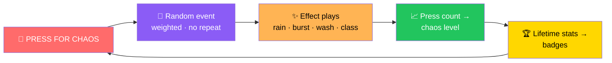
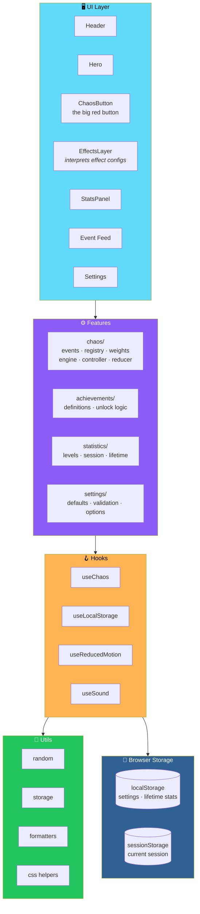

# 💥 Chaos Button

<div align="center">


**One button. Infinite bad decisions.**

*A playful browser-only web toy — every press fires a random, harmless, ridiculous event.*

[🚀 Install](#-installation) • [✨ Features](#-feature-highlights) • [🎲 How Chaos Works](#-how-the-chaos-event-system-works) • [♿ Accessibility](#-accessibility-and-performance-notes) • [🚢 Deploy](#-deployment)

</div>

---

## 📖 Overview

**Chaos Button** is a **playful, browser-only web toy** built with **React, TypeScript, and Vite**.

The whole site revolves around **one giant button: PRESS FOR CHAOS**.

Every press fires a **random, harmless, ridiculous event**:

- 🌧️ **Emoji rain**
- 🏚️ **An earthquake**
- ⏳ **A fake loading bar**
- 🧠 **An existential crisis**

…and you earn **chaos levels** and **badges** as you go.

### Core Idea

> **One button. Everything else is consequence.**
>
> 18 events. Weighted selection. No repeats in a row. No backend, no accounts, no analytics.

### The Loop



---

## ✨ Feature Highlights

<div align="center">

| 🎲 18 Chaos Events | 📈 Chaos Levels |
|:---:|:---:|
| **15 standard + 3 rare** *(Rainbow Overload, The Void, Supreme Chaos)* · **weighted random selection** · **the same event never fires twice in a row** | From ***Curious*** to ***CHAOS LEGEND*** — based purely on **press count** · with a **level-up celebration** |
| **🏆 7 Achievement Badges** | **😂 Funny Message Generator** |
| With **progress bars** for the locked ones | Several messages per event · **no immediate repeats** · **rare events get a special style** |
| **📊 Live Stats & Event Feed** | **🎨 Themes & Customization** |
| **Last 20 events**, clearable | **Light · Dark · Chaos** · **5 button colours** · **4 emoji particle themes** · **3 animation intensities** *(Reduced · Normal · Extra)* |
| **🔊 Optional Sound** | **♿ Accessible & Responsive** |
| **Off by default** · synthesized with **Web Audio API** — **no audio files** | **Keyboard friendly** · **reduced-motion aware** · **tested down to a 375px-wide phone** |
| **🌐 No Backend** | |
| **Everything runs and is stored in your browser** | |

</div>

### 🎲 The 18 Events

**15 standard + 3 rare:**

- ✨ **Rainbow Overload** *(rare)*
- 🕳️ **The Void** *(rare)*
- 👑 **Supreme Chaos** *(rare)*

> 💡 **With the current registry, rare events appear roughly 5% of the time.**

---

## 🛠️ Technology Stack

<div align="center">

| Library | Role |
|---------|------|
| **React 18** *(hooks)* | UI |
| **TypeScript** *(strict)* | Language |
| **Vite 5** | Build tool |
| **Tailwind CSS 3** | Styling |
| **Framer Motion 11** | Animation |
| **Lucide React** | Icons |
| **Vitest 2** + **React Testing Library** | Testing |
| **ESLint 9** *(flat config)* | Linting |
| **Browser storage** | Settings, stats, and badges |

</div>

---

## 📋 Prerequisites

- **Node.js 18.18 or newer** *(20 LTS or newer recommended)*
- **npm 9 or newer**

---

## 🚀 Installation

```bash
git clone <your-repo-url> chaos-button
cd chaos-button
npm install
```

---

## 🛠️ Development Commands

**These are the exact scripts from `package.json`:**

<div align="center">

| Command | What It Does |
|---------|--------------|
| **`npm run dev`** | Start the Vite dev server with hot reload |
| **`npm run build`** | Type-check *(`tsc -b`)* and create the production build in `dist/` |
| **`npm run preview`** | Serve the production build locally |
| **`npm test`** | Run all tests once *(`vitest run`)* |
| **`npm run test:watch`** | Run tests in watch mode |
| **`npm run lint`** | Lint the project with ESLint |
| **`npm run typecheck`** | Type-check without emitting files |

</div>

---

## 📦 Production Build and Preview

```bash
npm run build
npm run preview
```

> ✅ **Vite is configured with `base: './'`** — **so the build works from any path**.
>
> **No environment variables are needed.**

---

## 🧪 Testing and Linting

```bash
npm test
npm run lint
npm run typecheck
```

### What the Tests Cover

<div align="center">

| Area | Coverage |
|------|:--------:|
| **Chaos engine** — unique IDs · weighted selection · previous-event avoidance · single-event registries · deterministic injected randomness | ✅ |
| **Levels and achievements** | ✅ |
| **Persistence and reset behavior** — including corrupt JSON and blocked storage | ✅ |
| **The effect controller's** cleanup and particle budget | ✅ |
| **Main UI flows** — pressing · stats · feed · settings · reset dialogs · accessible names | ✅ |

</div>

> 💡 **Tests avoid asserting exact animation timing** — timing is not part of the contract.

---

## 🏗️ Architecture

### System Overview



### 🎲 How the Chaos Event System Works

> **Every event is plain data.**

**In `src/features/chaos/chaosEvents.ts`, each event has:**

- **An ID**
- **A name**
- **An emoji**
- **A description**
- **A rarity**
- **A duration**
- **Messages**
- **A list of effect configs** — `rain`, `burst`, `wash`, or `class`

**The `EffectsLayer` component interprets those configs** — **so the app has no per-event branching**.

### 🎯 Selection — `chaosEngine.ts`

<div align="center">

| Event Type | Weight |
|-----------|:------:|
| **Standard** | **10** |
| **Rare** | **3** |
| **Supreme Chaos** | **1.5** |

</div>

- **The previous event is excluded when an alternative exists**
- **Randomness is injectable** — for testing

### 🎼 Coordination — `chaosController.ts`

> **One controller owns every timer.**

<div align="center">

| Rule | Implementation |
|------|---------------|
| **Caps simultaneous effects** | **At 4** |
| **Shares a particle budget** | **150 particles** |
| **Repeats** | A **repeated event replaces** instead of stacking |
| **Hidden tab** | **Cancels everything** |
| **Unmount** | **Cancels everything** |

</div>

### ➕ Adding an Event

**Append a definition to `chaosEvents.ts`** — the **engine, feed, stats, and achievements pick it up automatically**.

**For a new visual type:**

1. Add **one `EffectConfig` variant**
2. Render it in **`EffectsLayer`**

### Design Principles

<div align="center">

| Principle | Implementation |
|-----------|---------------|
| **📊 Events are data** | Every event is a plain object — the engine, feed, stats, and achievements are driven by it |
| **🎲 Weighted randomness, injectable** | Standard, rare, and Supreme Chaos have distinct weights — and randomness can be injected for tests |
| **🔁 No immediate repeats** | The previous event is excluded when an alternative exists |
| **🎼 One owner for timers** | `chaosController.ts` owns all timers — no scattered `setTimeout` calls |
| **🧊 Bounded effects** | Max **4 simultaneous effects**, **150-particle budget**, hidden-tab cancellation |
| **♿ Reduced motion wins** | `prefers-reduced-motion` **always overrides app settings and the Chaos theme** |
| **🔒 No rapid flashing** | Effects use **slow gradients, fades, and transforms only** |
| **🌐 No backend, no analytics** | Everything runs and is stored locally |
| **🛡️ Storage failure is safe** | Corrupt or unavailable storage **never crashes the app** |

</div>

### 📂 Project Structure

```
chaos-button/
├── public/
│   └── favicon.svg
│
├── src/
│   ├── components/            UI
│   │                          Header · Hero · ChaosButton
│   │                          EffectsLayer · StatsPanel · …
│   │
│   ├── features/
│   │   ├── chaos/             events · registry · weights
│   │   │                      engine · controller · reducer
│   │   ├── achievements/      definitions and unlock logic
│   │   ├── statistics/        levels · session and lifetime stats
│   │   └── settings/          defaults · validation · options
│   │
│   ├── hooks/                 useChaos · useLocalStorage
│   │                          useReducedMotion · useSound · …
│   │
│   ├── utils/                 random · storage
│   │                          formatters · css helpers
│   │
│   ├── types/index.ts
│   ├── test/                  test setup
│   ├── App.tsx · main.tsx · index.css
│
├── tests/
│   └── chaosEngine.test.ts
│
├── netlify.toml · vercel.json
└── README.md · LICENSE
```

---

## 📈 Levels, Achievements, and Local Persistence

### 📈 Levels — Based on **Session** Presses

<div align="center">

| Level | Title | Presses |
|:-----:|-------|:-------:|
| **1** | **Curious** | 1–10 |
| **2** | **Trouble Maker** | 11–25 |
| **3** | **Chaos Agent** | 26–50 |
| **4** | **Certified Menace** | 51–100 |
| **5** | **CHAOS LEGEND** | 101+ |

</div>

### 🏆 Achievements — Based on **Lifetime** Stats

**Seven badges:**

1. **First Contact**
2. **Button Addict**
3. **Rare Collector**
4. **Chaos Legend**
5. **Everything Is Broken**
6. **Triple Threat**
7. **Seen It All**

### 💾 Data Storage

<div align="center">

| Data | Where | Cleared By |
|------|-------|-----------|
| **Settings** | `localStorage` | **Never resets** *(you change them yourself)* |
| **Lifetime stats and badges** | `localStorage` | **Reset all progress** |
| **Current session** | `sessionStorage` | **Reset session** or **closing the tab** |

</div>

### 🔄 Reset Behavior

<div align="center">

| Action | What It Does |
|--------|-------------|
| **Reset session** | Starts a fresh session — **keeps lifetime stats and badges** |
| **Reset all progress** | Erases lifetime stats, badges, **and** the session — **asks for confirmation first** and **keeps your settings** |

</div>

> ✅ **Corrupt or unavailable storage never crashes the app.**
>
> **Bad fields fall back to defaults** — **and a dismissible notice explains what happened.**

---

## ♿ Accessibility and Performance Notes

<div align="center">

| Principle | Implementation |
|-----------|---------------|
| **🧭 Semantic structure** | **Semantic landmarks** · **skip link** · **visible focus rings** · **labelled icon-only buttons** |
| **📢 Screen reader announcements** | **A single polite live region** announces each event message. **Rarity is written out as text** — not only colour |
| **🔒 Modal dialog** | **Traps focus** · **closes on Escape** · **returns focus afterwards** |
| **🎬 Reduced motion wins** | **`prefers-reduced-motion` always wins** over app settings and the Chaos theme. **Moving particles are replaced with calm fades** |
| **🚫 No rapid flashing** | Effects use **slow gradients, fades, and transforms only** |
| **⚡ Efficient animation** | Animations use **`transform` and `opacity`** · **particles are capped** · **smaller screens get fewer particles** · **decorative animation pauses when the tab is hidden** |

</div>

---

## 🚢 Deployment

> **Both platforms detect Vite automatically. Config files are included.**

### 🔺 Vercel

1. **Push the repository to GitHub**
2. In Vercel choose **Add New → Project** and import the repo
3. Keep the detected settings — **build `npm run build`**, **output `dist`** — and deploy

### 🟢 Netlify

1. **Push the repository to GitHub**
2. In Netlify choose **Add new site → Import an existing project** and pick the repo
3. **Build command `npm run build`**, **publish directory `dist`** *(already set in `netlify.toml`)* — then deploy

> ✅ **Verify locally first with `npm run build && npm run preview`.**

---

## 🔒 Privacy

> **There is no backend, account, analytics, or network request for data.**
>
> **Settings, statistics, and badges are stored only in your browser's storage** — and **never leave your device**.

---

## 🔧 Troubleshooting

<div align="center">

| Problem | Solution |
|---------|---------|
| **Progress is not saved** | Your browser may **block storage** *(private mode or strict settings)*. The app **shows a notice and still works** |
| **Few or no animations** | Check **Animation intensity** in *Customize* — and your operating system's **reduced-motion** setting |
| **No sound** | **Sound is off by default.** Turn it on with the **speaker icon**. **Browsers only start audio after a click** |
| **`npm install` peer dependency errors** | Use the versions in `package.json`. **ESLint is pinned to v9** because `@eslint/js` v10 requires **ESLint 10** |

</div>

---

## 🖼️ Screenshots

> ⚠️ **No screenshots are committed yet.**

**Run the app and add your own to a `docs/` folder:**

| View | File |
|------|------|
| **Desktop home** | *placeholder: `docs/screenshot-desktop.png`* |
| **Mobile home** | *placeholder: `docs/screenshot-mobile.png`* |

---

## 🤝 Contributing

Contributions are welcome. Please:

1. **Fork the repo and create a branch**
2. **Make your change with tests where it makes sense**
3. **Run all four checks** — all must pass:
   ```bash
   npm run lint
   npm run typecheck
   npm test
   npm run build
   ```
4. **Open a pull request describing what changed and why**

### Guidelines

- **Keep jokes original**
- **Keep effects free of rapid flashing** — accessibility is not optional
- **Add new events as data** — no per-event branching in the UI
- **Respect `prefers-reduced-motion`** — it always wins
- **Keep the particle budget** — never exceed 150 particles or 4 simultaneous effects

---

## 🗺️ Roadmap

### ✅ Current

- [x] React 18 + TypeScript (strict) + Vite 5 foundation
- [x] Tailwind CSS 3 styling with Framer Motion 11 animations
- [x] 18 chaos events — 15 standard + 3 rare
- [x] Weighted random selection with injectable randomness
- [x] No consecutive repeats — previous event excluded when an alternative exists
- [x] Chaos levels from *Curious* to *CHAOS LEGEND*
- [x] Level-up celebration
- [x] 7 achievement badges with progress bars
- [x] Funny message generator with no immediate repeats
- [x] Rare event styling
- [x] Live stats and clearable event feed (last 20 events)
- [x] Light, Dark, and Chaos themes
- [x] 5 button colours
- [x] 4 emoji particle themes
- [x] 3 animation intensities — Reduced, Normal, Extra
- [x] Optional synthesized sound via Web Audio API
- [x] Semantic landmarks, skip link, visible focus rings, labelled icon-only buttons
- [x] Single polite live region for event announcements
- [x] Modal confirmation dialog with focus trap and Escape handling
- [x] `prefers-reduced-motion` overrides all app settings
- [x] No rapid flashing — slow gradients, fades, and transforms only
- [x] Efficient animation — transform/opacity only, capped particles
- [x] Reduced particle count on smaller screens
- [x] Decorative animation pauses when the tab is hidden
- [x] Effect controller with a single timer owner, max 4 simultaneous effects, and a 150-particle budget
- [x] Safe storage handling with default fallback and user-facing notice
- [x] Reset session and reset all progress with confirmation
- [x] Settings persist and are never wiped by resets
- [x] Test suite covering the engine, levels, achievements, persistence, effects, and UI flows
- [x] ESLint 9 flat config
- [x] Netlify and Vercel deployment configuration
- [x] No backend, no accounts, no analytics
- [x] Relative-path build that works from any deployment path

### 🔜 Future Ideas

- [ ] **Committed screenshots** — desktop and mobile views
- [ ] **More events** — beyond the current 18
- [ ] **More achievement badges** — beyond the current 7
- [ ] **Custom event creator** — for power users
- [ ] **Shareable results** — a card with your chaos level
- [ ] **Local leaderboard** — highest chaos level reached
- [ ] **Additional themes** — seasonal and event-specific
- [ ] **Sound pack variants** — synthesized, per theme
- [ ] **Localization** — bilingual UI
- [ ] **PWA support** — install and play offline

---

## 📜 License

**MIT** — see [LICENSE](./LICENSE) for details.

---

## 🙏 Acknowledgments

- **Framer Motion** — for making chaos feel intentional
- **Web Audio API** — for a toy with zero audio files
- **Every button that was never meant to be pressed this many times** — this one's for you

---

<div align="center">

### 💥 PRESS FOR CHAOS. PRESS AGAIN. KEEP PRESSING.

**One button. Infinite bad decisions.**

**No backend. No analytics. Everything stays in your browser.**

<br>

⭐ If Chaos Button made you laugh, consider giving it a star.

<br>

[⬆ Back to Top](#-chaos-button)

</div>
